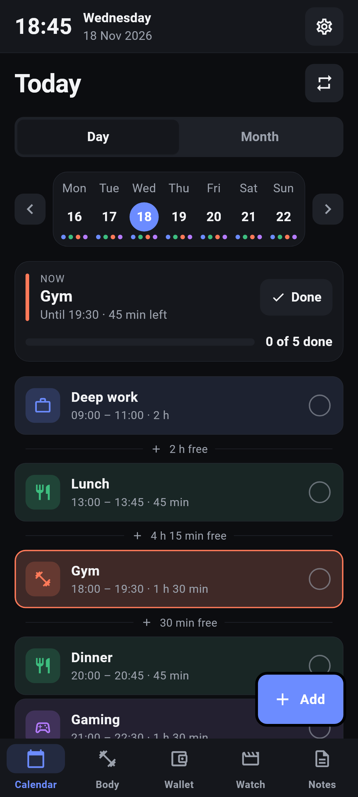
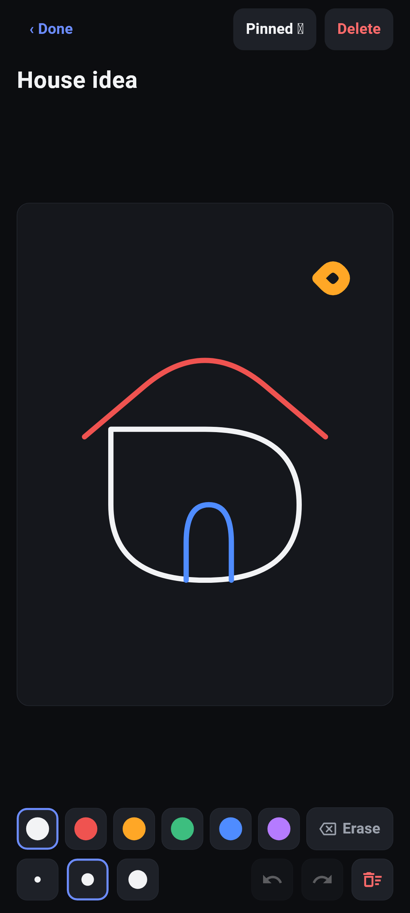
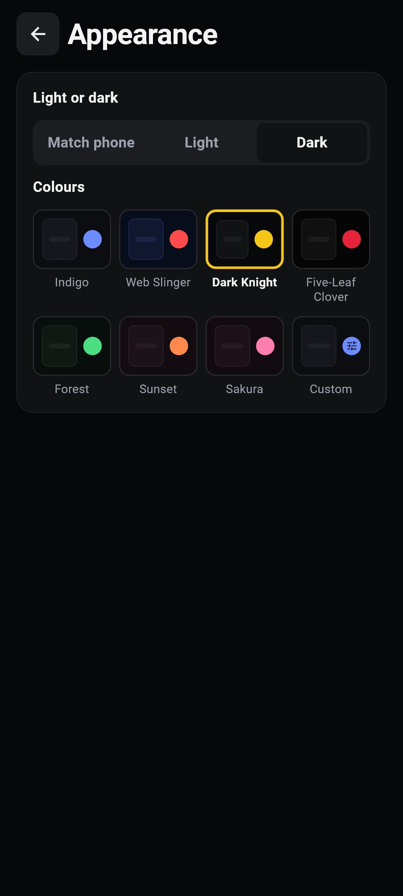

# HYETI

A personal planner for Android. Calendar, gym and food log, wallet, watchlist and notes in one app, with everything saved on the phone. The time and date stay in a bar at the top of every tab. No account, no sync, no ads.

**[Download the APK](https://github.com/Mohamed-Rayene-Trabelsi/HYETI/releases/latest/download/HYETI.apk)** · [All releases](https://github.com/Mohamed-Rayene-Trabelsi/HYETI/releases)

<p>
  
  
  
  
  
</p>

## What's in it

- **Home-screen widgets.** "Sketch" shows your newest sketch; tap it to keep drawing, or tap Draw for a blank canvas. Sketches are saved to Notes. "Savings jar" shows a jar of coins filling towards your savings goal, with a button to drop more in.
- **Calendar.** Set up a weekly routine once and it fills in every day. Day and month views. Blocks are added from one sheet: pick one of sixteen activities, a start time and a one-tap length. Days off (weekdays and single dates) are set in Settings, and work blocks stay off them.
- **Body.** A muscle map that shows what you trained and what has rested long enough, with exercise suggestions and set logging. There is a countdown for your gym membership, and a nutrition side with a calorie and macro plan and a food log.
- **Wallet.** Income, spending and savings, a weekly budget, and a savings goal shown as a jar of coins that fills up (and cheers at every quarter) as you drop money in. Photograph a receipt and the amount, shop and date are filled in for you; the picture is read on the phone and never leaves it.
- **Watch.** A watchlist for shows (movies and series), anime and football, with what's popular, what's coming out, and your football: the first time, pick your country, your clubs and any of the five big leagues, and see the next two weeks of their matches. Your country's and clubs' matches go on your calendar by themselves. Not into football? Say so once and the tab goes away. Search runs as you type. A watch night or a match can go straight onto the calendar.
- **Notes.** Written notes and finger-drawn sketches, which you can search and pin. Sketches have six pen colours, three pen sizes, an eraser, and undo and redo.
- **Settings.** Light or dark, eight colour themes (one of them yours to mix), your country and its currency, units, days off, and a button that erases everything.

## Install

1. On your phone, tap the download link above.
2. Open the file. Android will ask whether your browser may install apps; allow it.

Updating is the same: install the new APK over the old one and your data stays.

The APK is built for 64-bit ARM, which is almost every Android phone from 2017 onwards.

### Movies and series need a key

Anime and football work out of the box. For movies and series, get a free [TMDB](https://www.themoviedb.org/settings/api) key, and for IMDb ratings a free [OMDb](https://www.omdbapi.com/apikey.aspx) key, then paste them in under Settings. The keys stay on your phone.

## Build it yourself

You need [Flutter](https://docs.flutter.dev/get-started/install) and an Android phone with USB debugging on, or an emulator.

```bash
flutter run
```

Before sending changes, run the checks:

```bash
flutter analyze
```

```bash
flutter test
```

### Making a release

1. Raise `version` in `pubspec.yaml`, both parts (`1.0.1+2` becomes `1.0.2+3`). Android won't install a build over an older one unless the number after the `+` went up. Set `appVersion` in `lib/update.dart` to the same first part; the app compares it with the newest release to offer updates.
2. Build:

   ```bash
   flutter build apk --release --target-platform android-arm64
   ```

3. Rename `build/app/outputs/flutter-apk/app-release.apk` to `HYETI.apk` and attach it to a new [release](https://github.com/Mohamed-Rayene-Trabelsi/HYETI/releases/new) tagged with the version, for example `v1.0.2`. The download link at the top always points at the newest release, so the file name has to stay `HYETI.apk`.

One catch: the APK is signed with the debug key of the computer that built it. A build from another computer has a different signature, and Android refuses to install it over the existing app until that app is uninstalled, which wipes its data. Build releases on one computer, or set up a proper release key first.

## Where things are

| Path | What's there |
| --- | --- |
| `lib/main.dart` | App start and the five-tab shell |
| `lib/screens/` | One file per tab, plus settings |
| `lib/` (the rest) | Shared pieces: database, theme, widgets, date helpers, the muscle map, the sketch canvas, the Watch tab's API calls |
| `test/` | Unit and widget tests. `test/preview/` has screenshots drawn by `render_preview_test.dart` |
| `android/` | The Android project Flutter builds |

Data lives in SQLite on the phone. The only network calls are the Watch tab's lookups to AniList, TMDB, OMDb and FotMob (football fixtures, only for the teams and leagues you follow), and a check on start for a newer release on GitHub.

## Licence

[MIT](LICENSE)
