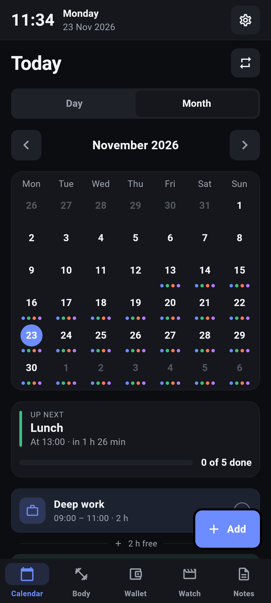
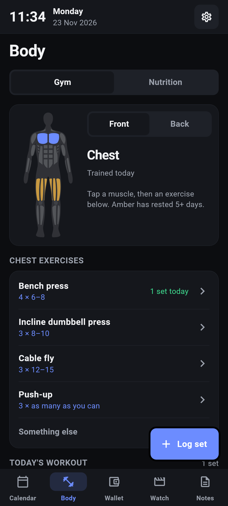

# HYETI

A personal planner for Android and iPhone. Calendar, gym and food log, wallet, watchlist and notes in one app, with everything saved on the phone. The time and date stay in a bar at the top of every tab. No account, no sync, no ads.

**[Download the APK](https://github.com/Mohamed-Rayene-Trabelsi/HYETI/releases/latest/download/HYETI.apk)** · **[iPhone: add the SideStore/AltStore source](https://github.com/Mohamed-Rayene-Trabelsi/HYETI/releases/latest/download/altstore.json)** · [All releases](https://github.com/Mohamed-Rayene-Trabelsi/HYETI/releases)

<p>
  
  
  
  
  
</p>

## What's in it

- **Home-screen widgets** (Android only). "Sketch" shows your newest sketch; tap it to keep drawing, or tap Draw for a blank canvas. Sketches are saved to Notes. "Savings jar" shows a jar of coins filling towards your savings goal, with a button to drop more in.
- **Calendar.** Set up a weekly routine once and it fills in every day. Day and month views. Blocks are added from one sheet: pick one of sixteen activities, a start time and a one-tap length. Days off (weekdays and single dates) are set in Settings, and work blocks stay off them.
- **Body.** A muscle map that shows what you trained and what has rested long enough, with exercise suggestions and set logging. There is a countdown for your gym membership (pick its length: 1, 2, 3, 6 or 12 months, and renew it in one tap), and a nutrition side with a calorie and macro plan and a food log.
- **Wallet.** What is in your wallet, income and spending, a weekly budget, and a savings jar kept apart from the wallet that fills up (and cheers at every quarter) as you drop money in. Each time, say whether the money comes out of your wallet or is new money, like a gift. Photograph a receipt and the amount, shop and date are filled in for you; the picture is read on the phone and never leaves it.
- **Watch.** The first time, say what you are into (movies, series, anime, manga, football) and which genres you enjoy, and only those show up. A watchlist for shows (movies and series), anime and football, with what's popular, what's coming out, and your football: the first time, pick your country, your clubs and any of the five big leagues, and see the next two weeks of their matches. Your country's and clubs' matches go on your calendar by themselves. Not into football? Say so once and the tab goes away. Search runs as you type, every list can be filtered by genre, and "For you" suggests movies, series and anime from what you saved. A watch night or a match can go straight onto the calendar.
- **Manga.** A reading list for manga, manhwa and manhua with the chapter you reached, one tap per chapter. Add titles from AniList's search or by hand, and bring a list in or out as a CSV file, from the clipboard, or from a link to a file in a GitHub repository or gist.
- **Notes.** Written notes and finger-drawn sketches, which you can search and pin. Sketches have six pen colours, three pen sizes, an eraser, and undo and redo.
- **Backup.** Save everything to one file and keep it off the phone (Google Drive, iCloud Drive, a message to yourself). Restoring it puts everything back, on the same phone or a new one, Android or iPhone.
- **Settings.** Grouped and labelled, with one Watch page for what you watch, favourite genres, the movie keys and the football you follow. Light or dark, eight colour themes (one of them yours to mix), your country and its currency, units, days off, and a button that erases everything.

## Install

### Android

1. On your phone, tap the download link above.
2. Open the file. Android will ask whether your browser may install apps; allow it.

Updating is the same: install the new APK over the old one and your data stays.

The APK is built for 64-bit ARM, which is almost every Android phone from 2017 onwards.

### iPhone

HYETI is not on the App Store. It installs through [SideStore](https://sidestore.io) or [AltStore](https://altstore.io), which sign it with your own free Apple ID. Needs iOS 15.5 or later.

1. Install SideStore (works from the phone alone after setup) or AltStore (refreshes from AltServer on your computer over Wi-Fi). Follow their guide once.
2. In SideStore or AltStore, open **Sources**, tap **+** and add:

   ```
   https://github.com/Mohamed-Rayene-Trabelsi/HYETI/releases/latest/download/altstore.json
   ```

3. Find HYETI in that source and tap **Free** / **Get**.

Updating: new versions show up in the store's **Updates** tab, and HYETI itself offers each one on start. Updating keeps your data.

With a free Apple ID, Apple lets a sideloaded app run for 7 days at a time. SideStore and AltStore refresh it in the background before then; if a refresh is missed, the app will not open until you refresh it, and your data is still there. A free Apple ID can have at most three sideloaded apps.

### Movies and series need a key

Anime and football work out of the box. For movies and series, get a free [TMDB](https://www.themoviedb.org/settings/api) key, and for IMDb ratings a free [OMDb](https://www.omdbapi.com/apikey.aspx) key, then paste them in under Settings. The keys stay on your phone.

## Build it yourself

You need [Flutter](https://docs.flutter.dev/get-started/install) and an Android phone with USB debugging on, or an emulator.

```bash
flutter run
```

Before sending changes, run the checks:

```bash
flutter analyze
```

```bash
flutter test
```

### Making a release

1. Raise `version` in `pubspec.yaml`, both parts (`1.0.1+2` becomes `1.0.2+3`). Android won't install a build over an older one unless the number after the `+` went up. Set `appVersion` in `lib/update.dart` to the same first part; the app compares it with the newest release to offer updates.
2. Build. This runs the checks, builds the APK, makes sure it is signed with the release key, and puts it in `release/HYETI.apk`:

   ```powershell
   powershell -ExecutionPolicy Bypass -File tooluild-release.ps1
   ```

3. Attach `release/HYETI.apk` to a new [release](https://github.com/Mohamed-Rayene-Trabelsi/HYETI/releases/new) tagged with the version, for example `v1.0.2`. The download link at the top always points at the newest release, so the file name has to stay `HYETI.apk`.

4. GitHub Actions (`.github/workflows/ios.yml`) then builds the iPhone app on a Mac and attaches `HYETI.ipa` and `altstore.json` to the same release, in about 15 minutes. Watch it under the repository's Actions tab. The tag must match the version in `pubspec.yaml` or that build stops. To try an iPhone build without releasing, run the workflow by hand from the Actions tab and download the IPA from its page.

### The signing key

Release APKs are signed with `android/hyeti-release.jks`, and `android/key.properties` holds its passwords. Neither is in git. Android installs an update only if it is signed with the same key as the app already on the phone, so **back up both files** (a USB stick, a password manager, a private cloud folder). Lose them, and the next version can only be installed by uninstalling HYETI first, which wipes its data (save a backup in the app before that). To build on another computer, copy both files into its `android/` folder.

## Where things are

| Path | What's there |
| --- | --- |
| `lib/main.dart` | App start and the five-tab shell |
| `lib/screens/` | One file per tab, plus settings |
| `lib/` (the rest) | Shared pieces: database, theme, widgets, date helpers, the muscle map, the sketch canvas, the Watch tab's API calls |
| `test/` | Unit and widget tests. `test/preview/` has screenshots drawn by `render_preview_test.dart` |
| `android/` | The Android project Flutter builds |
| `ios/` | The iPhone project, built only by GitHub Actions (it needs a Mac) |
| `.github/workflows/ios.yml` | Builds `HYETI.ipa` and the SideStore/AltStore source for each release |

Data lives in SQLite on the phone. The only network calls are the Watch tab's lookups to AniList, TMDB, OMDb and FotMob (football fixtures, only for the teams and leagues you follow), downloading a reading list from a link you paste, and a check on start for a newer release on GitHub.

## Licence

[MIT](LICENSE)
